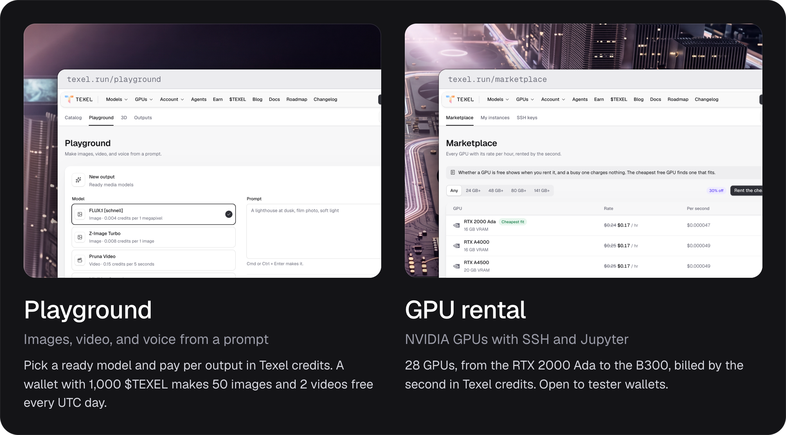

  <a href="https://texel.run">Website</a>
  ·
  <a href="https://texel.run/playground">Playground</a>
  ·
  <a href="https://texel.run/marketplace">GPU rental</a>
  ·
  <a href="https://texel.run/serverless">Serverless</a>
  ·
  <a href="https://texel.run/docs">Docs</a>
  ·
  <a href="https://texel.run/receipts">Receipts</a>
  ·
  <a href="https://texel.run/analytics">Analytics</a>
  ·
  <a href="https://texel.run/roadmap">Roadmap</a>
  ·
  <a href="https://texel.run/changelog">Changelog</a>
  ·
  <a href="https://x.com/texelrun">X</a>

  

## About Texel

The onchain GPU cloud on Robinhood Chain, for you or your agent. Rent NVIDIA GPUs, run your own AI
model, and make images, video, voice, and 3D from one wallet.

## Live on Texel

- **Wallet sign-in.** Your wallet is your account, and one signed message gets you in.
- **Images, video, voice, and 3D.** The Playground makes outputs from ready models, each paid per
  output, and an output keeps being made after you leave the page. One image also turns into a 3D
  asset, one GLB file with its textures.
- **GPU rental.** 28 NVIDIA GPUs with SSH and Jupyter, billed by the second in Texel credits. Every
  wallet that signs in rents.
- **Texel Serverless.** Run your own AI model, from Hugging Face or your own container, behind one
  endpoint for your app or agent. NVIDIA GPUs start with the requests and stop when they end, and
  each second is paid in Texel credits.
- **Texel credits.** Every wallet pays the Texel credits contract in USDG, ETH, $TEXEL, $NVDA,
  $SPCX, or $ANT. Uniswap swaps ETH and the stock tokens to USDG in the same transaction, and
  unused credits refund in USDG, or in the $TEXEL that paid for them. One credit pays for $1 of
  outputs and rentals at their listed prices and costs 0.70 USDG at launch.
- **API keys and agent budgets.** Call Texel from your own code or agent with a key. Each agent
  gets a spend cap and one switch that stops it, and only you can change them.
- **Texel Support.** An AI agent in the chat of every page answers from the docs, reads your
  credits, instances, outputs, and receipts once you sign in, and sends bug reports to the team.
- **Free outputs.** A wallet with 1,000 $TEXEL makes 50 images and 2 videos free every UTC day.
- **Onchain receipts.** Every rental and output gets a receipt, and each hour of receipts is sealed
  in one root on Robinhood Chain.
- **Earn.** Every wallet with $TEXEL gets tokenized NVDA every hour, split by how much $TEXEL each
  one holds.
- **Burn.** The $TEXEL of used credits burns every hour, and
  [Analytics](https://texel.run/analytics) shows each round of Earn and each burn with its
  transaction.

## Next

More handpicked tokens of Robinhood Chain to pay with, x402 payments for agents, and an MCP server.
The [roadmap](https://texel.run/roadmap) shows each one.

## Repositories

- [contracts](https://github.com/texellabs/contracts): `TexelReceipts`, `TexelEarn`, `TexelCredits`,
  `TexelDeposits`, and `TexelRefunds`, the contracts of Texel on Robinhood Chain.

## $TEXEL

[`0x0ddcab9ae04bda0c87ecc1640636fa11e8e613e8`](https://robin.etherscan.io/token/0x0ddcab9ae04bda0c87ecc1640636fa11e8e613e8)
on Robinhood Chain.
