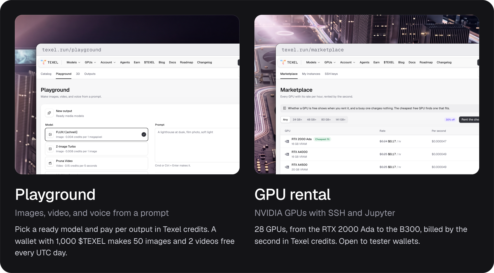

  <a href="https://texel.run">Website</a>
  ·
  <a href="https://texel.run/playground">Playground</a>
  ·
  <a href="https://texel.run/marketplace">GPU rental</a>
  ·
  <a href="https://texel.run/docs">Docs</a>
  ·
  <a href="https://texel.run/receipts">Receipts</a>
  ·
  <a href="https://texel.run/roadmap">Roadmap</a>
  ·
  <a href="https://texel.run/changelog">Changelog</a>
  ·
  <a href="https://x.com/texelrun">X</a>

## About Texel

The onchain GPU cloud on Robinhood Chain, for you or your agent. Rent NVIDIA GPUs and make images,
video, and voice from one wallet.

## Live on Texel

- **Wallet sign-in.** Your wallet is your account, and one signed message gets you in.
- **Images, video, and voice.** The Playground makes outputs from ready models, each paid per
  output, and an output keeps being made after you leave the page.
- **GPU rental.** 28 NVIDIA GPUs with SSH and Jupyter, billed by the second in Texel credits. Every
  wallet that signs in rents.
- **Texel credits.** Every wallet buys credits with one transfer of USDG to the Texel deposit
  contract. One credit pays for $1 of outputs and rentals at their listed prices and costs 0.70
  USDG at launch.
- **Free outputs.** A wallet with 1,000 $TEXEL makes 50 images and 2 videos free every UTC day.
- **Onchain receipts.** Every rental and output gets a receipt, and each hour of receipts is sealed
  in one root on Robinhood Chain.
- **Earn.** Every wallet with $TEXEL gets tokenized NVDA every hour, split by how much $TEXEL each
  one holds.

## Next

x402 payments for agents, API keys, a budget for each agent, and an MCP server. The
[roadmap](https://texel.run/roadmap) shows each one.

## Repositories

- [contracts](https://github.com/texellabs/contracts): `TexelReceipts`, `TexelEarn`, and
  `TexelDeposits`, the contracts of Texel on Robinhood Chain.

## $TEXEL

[`0x0ddcab9ae04bda0c87ecc1640636fa11e8e613e8`](https://robin.etherscan.io/token/0x0ddcab9ae04bda0c87ecc1640636fa11e8e613e8)
on Robinhood Chain.
